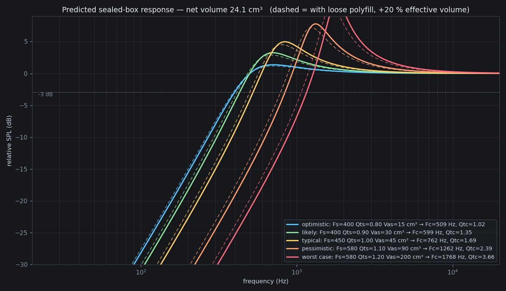

# 40 mm speaker case — evaluation & build package

Parametric OpenSCAD case for the **2 W / 8 Ω, Ø40 mm × 20 mm deep** miniature
speaker, split into **two FDM-printed parts that are glued together**. The
driver itself is glued into the baffle (no screws), so the case has no visible
fasteners. The rear face carries a **keyhole hanger** for wall mounting and a
**cable bend guide** so the wire is not pinched against the wall.

| | |
|---|---|
| Case envelope | **Ø50 × 35 mm** |
| Net trapped air | **24.1 cm³** (sealed, measured from the mesh) |
| Printed parts | 2 (front bezel + back cup), glued at a lap joint |
| Wall mount | keyhole hanger — undercut pocket, retains a 6 mm screw head |
| Cable guide | bend well + 3 radial channels out to the rim |
| Supports needed | **none** |
| Filament | ≈ 25 g PLA/PETG |

---

## 1. Files

| File | What it is |
|---|---|
| `speaker_case_40mm.scad` | The model. Fully parametric — open in the OpenSCAD GUI and use the **Customizer** panel. |
| `render_all.ps1` | Batch-exports every STL/DXF below (needs the OpenSCAD CLI on `PATH`). |
| `export/part_A_front_bezel.stl` | **Print this.** Front grille + driver seat + male lap spigot. |
| `export/part_B_back_cup.stl` | **Print this.** Back cup with keyhole + cable guide, already in print orientation. |
| `export/print_plate.stl` | Both parts laid out side by side, for a single-plate job. |
| `export/assembly.stl` | Both parts in the assembled pose — for viewing the fit. Not for printing. |
| `export/cavity.stl` | The net trapped-air volume, as a solid. Import it to see exactly what the driver is loading. |
| `export/section_2d_case.dxf` | CAD cross-section (for documentation / laser-cut overlays). |
| `export/acoustic_prediction.png` | The sealed-box response plot (analysis, §7). |
| `verify/mesh_check.py` | Re-checks any exported STL: bbox, volume, watertightness, topology. |
| `verify/acoustics.py` | Recomputes §7 — reads the volume from `cavity.stl`, so it cannot drift from the model. |

The parts are deliberately exported **already in the orientation you should
print them in**, so you can drop them straight into a slicer.

---

## 2. Dimensions

| Feature | mm |
|---|---|
| Case OD | Ø50.0 |
| Total assembled length | 35.0 |
| Side wall | 2.4 |
| Front plate / rear wall | 3.0 / 3.0 |
| Grille aperture | Ø36.0 |
| Driver seat bore | **Ø40.40** (0.20 radial glue gap) |
| Seat depth | 3.0 |
| Part B bore | Ø45.20 |
| Lap spigot on part A | **Ø44.80 × 4.0 long** |
| Lap clearance (glue line) | **0.20 radial** |
| Cable hole | Ø4.0 at r16, with a glue boss |
| Keyhole entry / slot | Ø8.4 / 4.4 × 8.0 |
| Keyhole pocket | **5.0 deep = 1.5 lip + 3.5 head cavity** |
| Cable well / channels | Ø14.0 × 2.2 deep / 3.4 × 2.0 deep |
| Chamfers / lead-ins | all 45° |

### How the joint works

Part A ends in a reduced-diameter **spigot (Ø44.80)** that slides 4 mm into
part B's full-diameter rim bore (Ø45.20). That gives:

* a **cylindrical glue face** — self-aligning, resists shear and side loads;
* a **flat annular glue face** (≈ 270 mm²) — the actual airtight seal.

There is no shoulder to get wrong and no way to assemble it crooked. Both parts
are rotationally symmetric, so rotational alignment is irrelevant.

---

## 3. Wall mounting

A **keyhole hanger** is recessed into the rear face, on the opposite side from
the driver. Hang it on a screw with a **6 mm head**.

### It has to be an undercut, not just a keyhole-shaped hole

A keyhole only works if the screw head can sit **behind a narrower mouth**. The
pocket is therefore cut in two layers:

```
 z = 35.0  (rear face)  +-------------------------------+
                        |  LIP    1.5 mm — keyhole       |  <- retains the head
 z = 33.5               |         outline (Ø8.4 + slot)  |
                        +-------------------------------+
                        |  CAVITY 3.5 mm — 6.8 wide      |  <- the head travels
 z = 30.0               |         x 12.8 long            |     in here
                        +-------------------------------+
                        |  floor  1.5 mm                 |
```

A constant-section (prismatic) keyhole **cannot** work here. The head is
coaxial with the shank, so to reach the seated position it would have to fit
inside the narrow slot — and it would simply lift straight back out through the
entry hole, leaving nothing for the case to hang on. The head has to be free to
move behind the lip, which is what the wider cavity provides.

### Sequence

1. Screw into the wall, leaving the head standing ~3–4 mm proud.
   **The head must be under 3.5 mm tall** (a pan- or countersunk-head 3.5–4 mm
   screw is 2–3 mm).
2. Offer the case up with the **Ø8.4 entry hole** over the head and push it
   flat against the wall — the head passes through the entry hole into the
   cavity.
3. Let the case **slide down ~6 mm**. The shank rises into the 4.4 mm slot and
   the head moves up the cavity.
4. Seated: the shank rests on the **top of the slot**, which carries the case's
   weight, and the head is trapped behind the 1.5 mm lip — it overhangs the
   head by **0.8 mm on each side**, so the case cannot be pulled off the wall.
   To remove it, lift the case ~6 mm and pull it away.

The slot points up so gravity keeps the case seated. At ~80 g the loads are
small, but it is a hanging joint, not a load-bearing bracket.

**Why the pocket is blind.** A conventional keyhole is cut clean through the
panel. On a sealed box that is a permanent air leak straight into the chamber,
which would undo the whole acoustic design — so the pocket gets an internal pad
behind it and keeps a **1.5 mm floor**. It never breaks into the sealed volume.
(This is asserted in the SCAD and verified by ray-casting the mesh — see §8.)

---

## 4. Cable guide

The cable leaves through a Ø4 hole in the rear wall (r16, on the opposite side
from the keyhole slot). With the case flat against the wall there is no room
for the wire to turn, so the rear face carries:

* a **bend well** — Ø14 × 2.2 mm deep around the exit, giving the cable room to
  turn 90° out of the hole without being crushed;
* **three radial channels** — 3.4 mm wide × 2.0 mm deep, at −40°, 0° and +40°
  from the exit direction, each running out to the rim. Route the cable down,
  down-left or down-right to suit where the wall outlet is.

The channels open through the rim, so the cable leaves the case outline before
it has to run along the wall.

Like the keyhole, both features are **blind**: an internal pad sits under the
well so the recess keeps a **1.8 mm** floor (2.0 mm under the channels), rather
than thinning the 3 mm rear wall down to nothing. The SCAD asserts these floors
and refuses to render if a recess would break through.

If your cable is thicker than ~2 mm, either reduce `guide_deep` and run the
cable without using the channels, or increase `back_t` to buy depth — raising
`back_t` costs chamber volume, so check §7 before doing it.

---

## 5. 3D printing

Both parts print **without supports** and **without any special settings**.

| Setting | Value |
|---|---|
| Nozzle | 0.4 mm |
| Layer height | 0.20 mm |
| Perimeters / walls | **4 or more** (walls are 2.4 mm) |
| Top / bottom layers | 5 |
| Infill | 15–25 % (the parts are mostly wall already) |
| Supports | **none** |
| Orientation | use the exported orientation: part A grille-face down, part B rear-face down |
| Filament | PLA or PETG, ≈ 25 g total (11.5 + 12.7 cm³ solid) |

**Why this prints cleanly:**

* Both **glue faces end up at the top** of their print. No elephant's-foot
  bulge on a mating surface, and top surfaces print truest. (If you re-orient
  the parts, this advantage is lost.)
* Every overhang is **exactly 45°** (all chamfers are 1:1). The only 45° faces
  are 0.5–0.8 mm tall, so even a printer that dislikes 45° will bridge them.
* Part A's **entire first layer is connected** — outer ring, hub, spokes and
  rings all touch the bed — so there is good adhesion and no floating grille.
* Part B is printed rear-face down, so the new keyhole and cable recesses open
  **upward into the print**. The head cavity is a closed 6.8 mm void whose
  ceiling closes over as a **6.8 mm bridge** — well inside normal capability;
  the keyhole mouth and cable well close over at 8.4 mm and 14 mm. Their
  undersides end up slightly rough, which is invisible facing the wall.
* The thinnest features are the **1.5 mm keyhole lip** and the **1.5 mm pocket
  floor**. Both are 3–4 extrusion widths and print solid.

**Two things that matter for a sealed box:**

1. **Do not use vase / spiral mode.** The 2.4 mm wall at 4+ perimeters is what
   makes the chamber airtight.
2. **Seal the cable hole.** Push the wires through, then pot the hole with hot
   glue or silicone. A leaky wire hole is the most common reason a small sealed
   box sounds thin.

### If something doesn't fit

The 0.20 mm radial clearances are a deliberate FDM compromise (glue fills the
gap; a tighter fit risks not assembling at all). Adjust in the SCAD:

| Symptom | Change |
|---|---|
| Spigot won't enter the rim bore | `lap_gap` 0.20 → 0.25 |
| Joint feels loose / sloppy | `lap_gap` → 0.15 (only if your holes print true) |
| Driver won't drop into the seat | `seat_gap` 0.20 → 0.25 |
| Driver rattles in the seat | `seat_gap` → 0.15 |
| Screw head bottoms out in the pocket | `key_depth` → 6.0 (pad grows automatically) |
| Case pulls off the keyhole too easily | lower `key_slot_w` to suit your shank (below) |

`key_slot_w` is the one wall-mount dimension worth matching to your hardware:
retention is `(key_head_d − key_slot_w)/2` per side, so a 6 mm head in a 4.4 mm
slot retains by 0.8 mm. A thinner shank lets you use a narrower slot and get
more. Keep `key_slot_w` at least ~0.4 mm above your actual shank diameter.

---

## 6. Assembly

1. Print both parts.
2. **Test-fit dry** — the spigot should slide into the rim bore with light
   hand pressure and no wobble.
3. **Glue the driver into part A.** It enters from the *rear* of part A and
   lands on the internal shoulder 3 mm behind the grille. It is a one-way
   operation: once the glue sets the driver is not coming out. Run a bead
   around the shoulder and the bore wall, then press the driver home.
   Let it cure **before** assembling the case.
4. **Route the cable** through part B's Ø4 hole (the hole has a boss on the
   inside so the glue has a throat to seal against).
5. **Glue the case shut.** Apply a *continuous* bead of CA or 5-minute epoxy
   to both the cylindrical spigot and the flat annular shoulder — the joint
   must be airtight, so no spot-gluing. Push part A into part B with a twist
   to spread the glue, then hold ~30 s (CA) or clamp (epoxy).
6. **Seal the cable hole** and let everything cure fully before playing
   anything loud — an uncured joint will buzz.
7. Hang it on the wall and lay the cable into whichever guide channel points
   at your outlet.

---

## 7. Acoustic evaluation

This is the part that actually needed evaluating, because a Ø40 mm driver in a
35 mm-deep cup is a *small* box.

### Method

The chamber volume was not estimated — it is a **measured property of the
model**. A `cavity` solid (case interior minus the driver keep-out solid and
minus every internal boss) is exported to STL and its volume computed from the
triangles by the divergence theorem. Result: **24.12 cm³**, against an
independent closed-form calculation of 24.07 cm³ (the small gap is the
documented overlap between the internal bosses, which the closed form
over-subtracts).

Fitting the keyhole and cable guide cost only about **0.6 cm³** — under 3 % of
the chamber — which is why the acoustics barely moved.

Sealed-box theory then gives, with `α = Vas/Vb`:

```
fc  = Fs · √(1 + α)          Qtc = Qts · √(1 + α)
```

### The driver parameter problem

`Fs` is well documented for this driver class (400 Hz for the PUI
AS04008MR-2; 580 Hz for the Visaton K 28.40 H). **`Vas` and `Qts` are almost
never published** for 2 W miniature drivers, so they are swept rather than
guessed. Note that for a 40 mm driver `Vas` typically lands in the
**10–90 cm³** range — the same order as the box itself, which is why the box
does not wreck the bass as badly as one might fear.



| Scenario | Fs | Qts | Vas | Fc | Qtc | peak | F3 |
|---|---|---|---|---|---|---|---|
| optimistic | 400 | 0.80 | 15 cm³ | 509 Hz | 1.02 | +1.4 dB | 397 Hz |
| **likely** | **400** | **0.90** | **30 cm³** | **599 Hz** | **1.35** | **+3.2 dB** | **428 Hz** |
| typical | 450 | 1.00 | 45 cm³ | 762 Hz | 1.69 | +5.0 dB | 523 Hz |
| pessimistic | 580 | 1.10 | 90 cm³ | 1262 Hz | 2.39 | +7.8 dB | 838 Hz |
| worst case | 580 | 1.20 | 200 cm³ | 1768 Hz | 3.66 | +11.3 dB | 1154 Hz |

### Verdict

**For the likely driver, the box is fine.** The −3 dB point lands at ≈ 428 Hz
against a free-air `Fs` of 400 Hz — in other words the enclosure costs almost
nothing in bass extension. The audible artifact is a **mild +3 dB lift around
600 Hz**, which reads as slightly "boxy" but is not objectionable and is
exactly what a loose polyfill fill flattens (dashed curves: +3.2 → +2.9 dB).

**The risk is a driver with a large Vas.** If your actual driver is in the
90–200 cm³ range the box will sound noticeably boxy and thin (Qtc > 2). That is
the one scenario worth guarding against, and it is easy to check — see §9.

**Loose polyfill** (a pinch of synthetic filling, ~0.3 g, not packed) raises
the effective volume ~20 % and damps the peak. Recommended.

### Should the case be bigger?

Going bigger helps, but with sharply diminishing returns. For the likely
driver:

| `case_len` | Vb | Qtc | peak | F3 |
|---|---|---|---|---|
| 35 mm *(this design)* | 24.1 cm³ | 1.35 | +3.2 dB | 428 Hz |
| 40 mm | 30 cm³ | 1.27 | +2.8 dB | 410 Hz |
| 50 mm | 40 cm³ | 1.19 | +2.4 dB | 390 Hz |

The chosen 35 mm already sits at the knee of that curve. Stretching the case to
50 mm buys 0.8 dB and 38 Hz — not worth the size for a prop. `case_len` is the
one knob to turn if you disagree; everything else re-derives automatically.

Note that `back_t` (rear wall thickness) also trades against volume, because it
sets how deep the keyhole and cable recesses can be. At 3.0 mm the recesses
work but the floors are thin; if you want more margin there, raise `back_t` and
compensate with `case_len`.

---

## 8. What was verified, and how

The model was rendered with OpenSCAD 2021.01 and the exported meshes were then
re-checked independently rather than trusted:

| Check | Result |
|---|---|
| Envelope | part A Ø50 × 16, part B Ø50 × 23, assembled Ø50 × 35 — exact |
| Watertightness | every edge shared by **exactly 2 faces**, zero boundary and zero non-manifold edges, for every exported STL |
| Topology | each part is a **single connected shell** (part A genus 18 = 18 grille apertures; part B genus 1 = cable hole) |
| No interpenetration | part A volume + part B volume = assembly volume exactly (11.52 + 12.75 = 24.27 cm³), so the two parts meet without overlapping |
| Chamber volume | 24.12 cm³ from the mesh vs 24.07 cm³ closed-form |
| **Keyhole undercut** | ray-cast through the exported solid at the seated head position: at x = ±2.6 mm (outside the 4.4 mm slot, inside the 6.8 mm cavity) the material runs **33.5–35.0** (the 1.5 mm lip) above a **void from 30.0–33.5**, so the head is genuinely trapped behind the lip |
| **Recess floors** | ray-cast: keyhole pocket floor **1.50 mm**, cable well **1.80 mm**, plain rear wall 3.00 mm — all match the intended values, and **no recess breaks into the chamber** |
| Cross-section | rasterised slice of the exported solid matches hand-computed area (driver 664.4 mm² vs 664 mm² analytic) |
| Overhangs | all chamfers verified 1:1 (45°) by construction of the revolved profiles |

### Defects found and fixed during development

Worth listing, because each was caught by a check rather than by looking:

1. The grille ribs were being subtracted away by the aperture they sit in
   (caught by the section outline, and by part A's volume being *lower* than a
   ribless version).
2. The driver seat's lead-in funnel was inverted, so it never formed.
3. Chamfers built by subtracting near-tangent cones left 0.01 mm sliver shells
   detached from the part — which is why both parts are now built as **single
   exact revolved profiles**.
4. The first keyhole was **prismatic**, so the head had no room to reach a
   seated position and the case could be lifted straight off. Now a two-layer
   undercut (§3).
5. The mount pad was **shifted by `key_cy` twice** (a frame mix-up), leaving the
   pocket floor unsupported at the top of the head's travel. Caught by
   ray-casting, and confirmed fixed by re-probing the same point.

### Re-running the checks

The tooling is included (needs Python with `numpy`, `matplotlib` and `Pillow`):

```powershell
python verify\mesh_check.py export     # geometry + watertightness table
python verify\acoustics.py  export     # rebuild acoustic_prediction.png
```

---

## 9. Verifying against *your* driver

Everything above is parameterised on `Vas`/`Qts` because those are unknown.
You can measure them in ten minutes without any test gear beyond a phone:

1. Play a sine sweep through the bare driver (not in the box) and find the
   frequency where the cone moves most / the impedance peaks. That is `Fs`.
2. Glue the driver into part A, seal the case, and repeat. That new peak is the
   **in-box** resonance `fc`.
3. The ratio gives the diagnosis directly:

   ```
   fc / Fs = √(1 + Vas/Vb)
   ```

   * `fc/Fs` ≈ 1.2–1.5 → the box is well matched. Nothing to do.
   * `fc/Fs` ≈ 2 → boxy. Add polyfill, and consider `case_len` 45–50 mm.
   * `fc/Fs` > 2.5 → the driver really wants a much bigger box than a 40 mm
     puck allows.

Also worth measuring before printing: `drv_od`, `drv_flange_h` (height of the
driver's straight full-diameter wall — sets the seat depth) and `drv_cone_d`.
The defaults assume Ø40 / 3.0 / Ø36.

---

## 10. Changing the design

Open `speaker_case_40mm.scad` in the OpenSCAD GUI. The Customizer exposes every
parameter, and the `part_customizer` dropdown switches the output between
`assembly`, `front`, `back`, `all`, `section`, `exploded`, `cavity`, `driver`
and the 2D cross-sections `sec2d` / `sec2d_drv`.

The model also **self-reports** on every render: the console prints the chamber
volume before and after the internal bosses, the keyhole geometry (entry, slot,
lip thickness and retention, cavity size, head travel), the rear-wall floor
thicknesses, and the sealed-box `Fc`/`Qtc` for the parameter sweep above — so
if you change `case_len` or `key_depth` you immediately see the consequence.

Useful knobs:

| Parameter | Effect |
|---|---|
| `case_len` | chamber volume (and therefore Fc/Qtc) — the main acoustic knob |
| `mount` | `false` removes the keyhole entirely (and its pad) |
| `key_depth` | total pocket depth; raise it for a taller screw head — the pad grows to match |
| `key_lip` | retaining lip thickness; `key_depth − key_lip` is the head clearance |
| `key_slot_w` | slot width — sets both shank clearance and retention |
| `key_up` | slot direction when hung |
| `guide_dirs` | which ways the cable can leave (angles relative to `wire_ang`) |
| `wire_ang`, `wire_off` | cable exit position |
| `grille` | `false` leaves the aperture fully open (more output, no cone protection) |
| `spokes`, `ring_rs`, `spoke_w` | grille pattern (default ≈ 50 % open area) |
| `drv_*` | driver dimensions — set these from your datasheet |

For CLI batch export, run `render_all.ps1`. Note it writes the tiny wrapper
files **without a UTF-8 BOM** on purpose: OpenSCAD's parser rejects a BOM.
