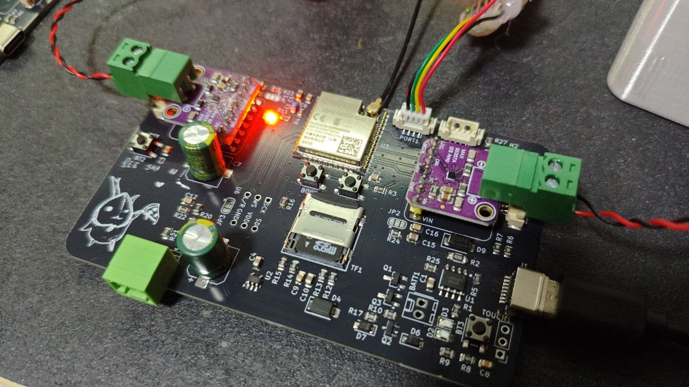
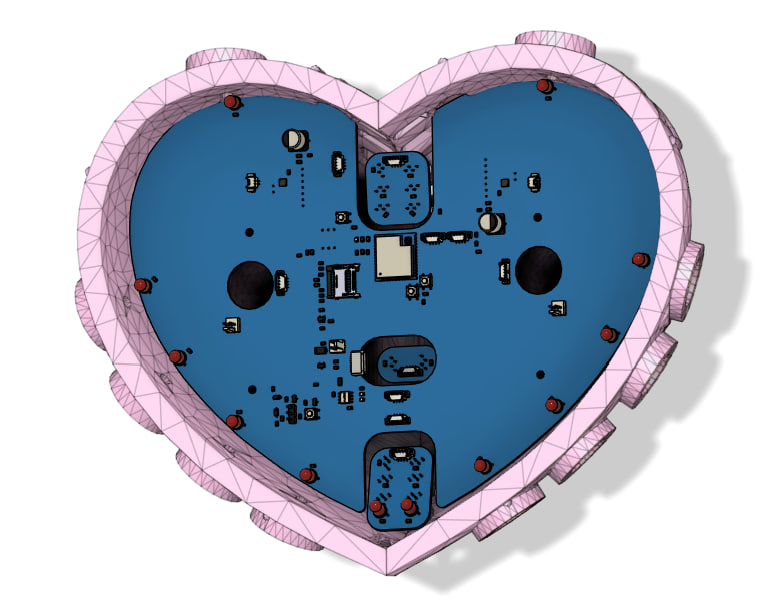
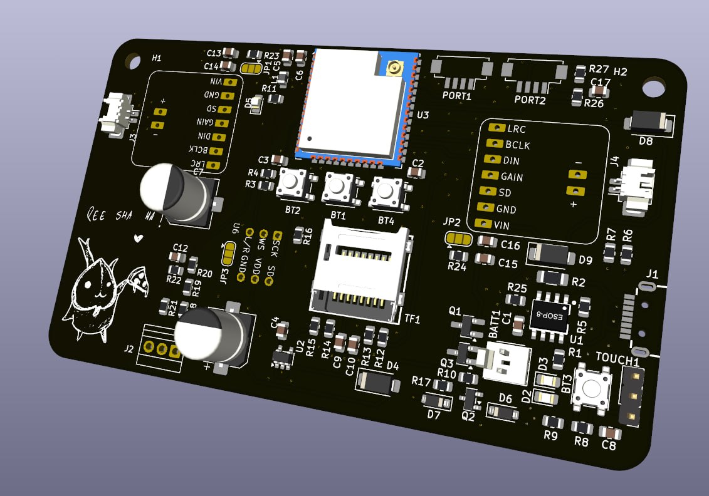
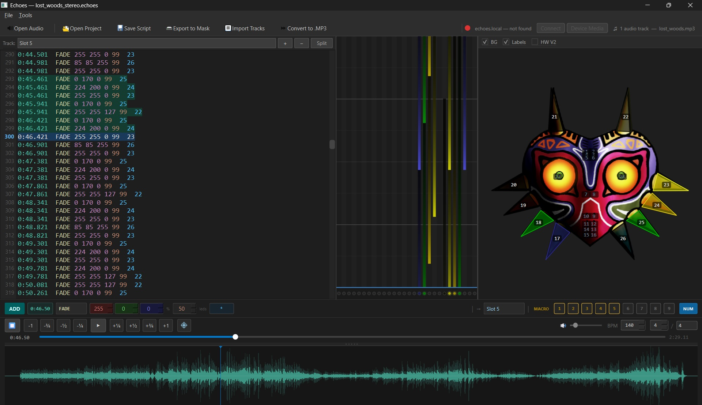
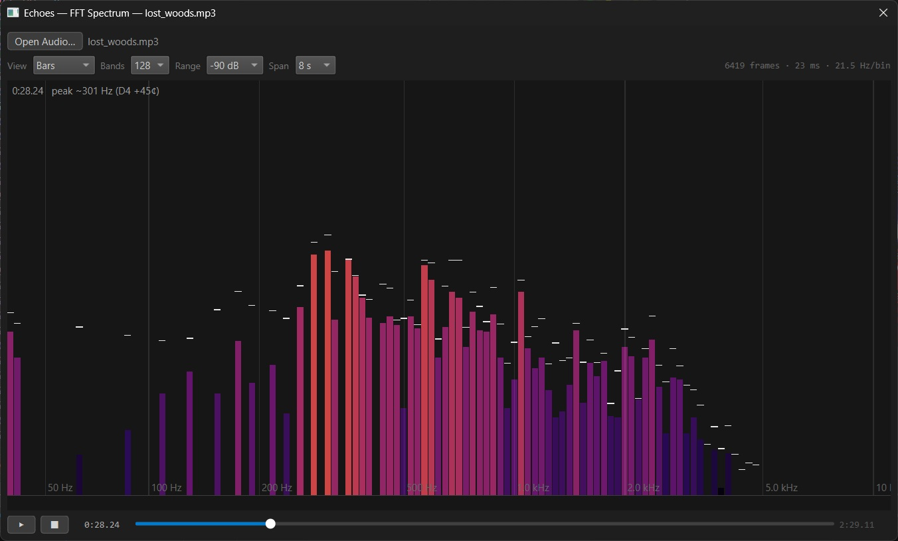
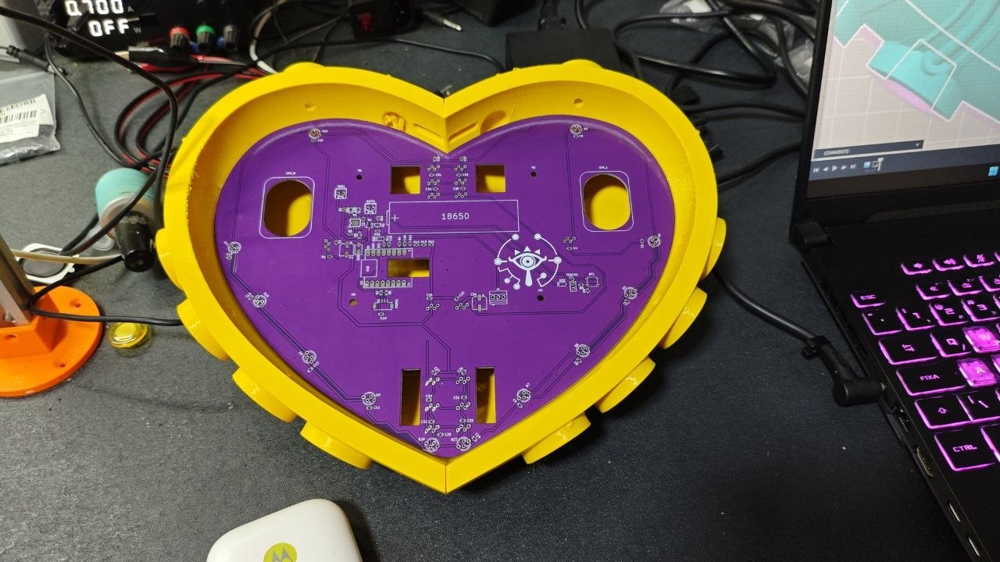
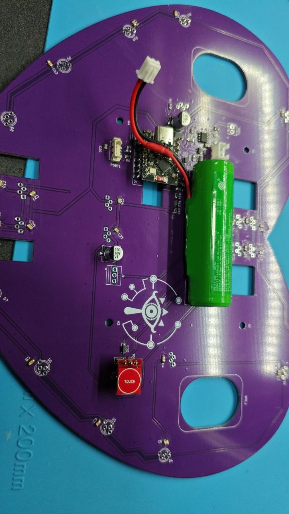

# Echoes of Termina

An audio-visual devkit built from simple parts: a battery-powered ESP32 board with
a stereo speaker output, addressable LEDs, a microSD card and two buttons — plus the
desktop tool that authors the lightshows it plays.



| | |
|---|---|
| **Hardware** | ESP32-WROOM-32 board, 2x MAX98357A I2S amplifiers, WS2812B output, microSD, TP4056 charger, 2 buttons |
| **Firmware** | Bluetooth A2DP sink, local SD playback, `.echoes` lightshow decoder, Wi-Fi control panel |
| **Desktop** | Python/PySide6 editor: drop in an MP3, draw the LED animation, upload the project to the board |
| **Status** | v0.8.0 pre-release — bench bring-up done, mask content and full board validation pending |

The project is three separable pieces that meet at the microSD card and the
`.echoes` script format: `Hardware/` (KiCad boards), `Firmware/` (PlatformIO /
Arduino for ESP32), and `Executable/` (the Windows editor and analyser).

---

## Hardware



Deliberately small bill of materials — an ESP32 module, two I2S class-D amplifiers, a
microSD socket, a charging IC, a handful of passives and the LED chain.

| Block | Part | Notes |
|---|---|---|
| MCU | ESP32-WROOM-32 N8R2 / 32UE | 8 MB flash, 2 MB PSRAM (see the pinout caveat below) |
| Speaker output | 2x MAX98357A (I2S) | stereo pair, channel chosen per amplifier by solder jumper; 4 Ω / 3 W drivers on PicoBlade connectors |
| Microphone input | INMP441 on I2S_NUM_1 | wired and pinned out, **not tested and not coded** |
| Storage | microSD over 1-bit SDMMC | CLK / CMD / D0; hinged socket on the mask boards, spring-loaded tray on Echoes V2 |
| LED output | 5 V WS2812B data line (`Strip_out`) | 1 to 200 pixels, brightness ceiling scaled to the count |
| Charging | TP4056 + USB-C | charge status LEDs |
| Power | AP2112K-3.3, PMOS latch on `latch_enable` | 2x 220 uF polymer + 100 nF decoupling, 220 mR sense resistor |
| Buttons | PROG (GPIO0, active low) + external (active high) | polled, debounced gesture layer |

### Boards

| Directory | What it is |
|---|---|
| `Hardware/PCBs/Echoes_of_Termina/` | The bench devkit board — the reference for the pinout and the first board to come up |
| `Hardware/PCBs/Echoes_V2/` | A second board revision kept as the upgrade path from `Echoes_of_Termina` — the bench board that takes a spring-loaded microSD tray |
| `Hardware/PCBs/Marajoara_V3/` | The mask board: ESP32-WROOM-32UE, 10 onboard WS2812B, DF13 ports for the LED strips, PSRAM usable |
| `Hardware/PCBs/Marajoara_V2/`, `Hardware/PCBs/Marajoara_PCB/` | Earlier revisions, kept for reference and upgrade paths |
| `Hardware/PCBs/LED breakout boards/Top_6_WS2812B/`, `Mid_2_WS2812B/`, `Bottom_8_WS2812B/` | Small daisy-chained LED carrier strips for the mask (6 / 2 / 8 pixels) |
| `Hardware/Printed parts/Basic Echoes case/` | Enclosure STLs for the bench board, plus its Fusion 360 archive (`Echoes box.f3z`) |
| `Hardware/Printed parts/Speaker_40mm_Case/` | Parametric OpenSCAD case for a 40 mm driver, with measured acoustics — see its own [README](Hardware/Printed%20parts/Speaker_40mm_Case/README.md) |

Every KiCad project lives under `Hardware/PCBs/` in its own directory, with that
board's fabrication outputs in its `production/` subdirectory; enclosure and printed
parts live under `Hardware/Printed parts/`.

The ESP32-C3 variant in `Media/` and `Firmware/Marajoara-C3/` has no board directory
here: it is legacy, has no microSD slot and no audio stage, and keeps its show in
internal flash instead.



### Pinout

Compile-time, selected per environment (`src/shared/pinout.h`); defining two
boards, or none, is a build error rather than a silent fallback.

| Signal | Echoes V1 (bench) | Marajoara V3 |
|---|---|---|
| I2S speaker DOUT / BCLK / LRC | 16 / 17 / 18 | 13 / 27 / 18 |
| I2S mic SCK / WS / SD | 27 / 26 / 34 | 26 / 25 / 34 |
| microSD CLK / CMD / D0 | 14 / 15 / 2 | 14 / 15 / 2 |
| LED data | 25 | 23 |
| Second LED data *(planned)* | — | 33 |
| Charger `CHRG#` / `STDBY#` *(planned)* | — | 4 / 35 |
| External button | 4 | 19 |
| Power latch | 13 | 32 |
| ADC input | 36 | 36 |
| I2C SDA / SCL | 21 / 22 | 21 / 22 |

The two rows marked *planned* belong to the next Marajoara revision, which is awaiting
manual routing and DRC; no built board carries them yet. They are recorded here because
that revision closes the pin budget: GPIO39 is then the only free pin, with GPIO5 and
GPIO12 left to their strapping roles and GPIO1/GPIO3 to the UART0 console. On V3 the
external button input is fed by a touch module, which presents itself as an ordinary
active-high press — no firmware difference.

The module's PSRAM chip owns GPIO16 and GPIO17 internally. Echoes V1 puts I2S on
both of those pins, so that environment must build with PSRAM disabled — the pinout
header asserts this and refuses to compile a contradictory combination. Marajoara V3
moved the amplifier onto pins the 1-bit SD bus no longer needs, which is what makes
PSRAM usable there.

---

## Firmware

Two mutually exclusive modes, chosen at boot from NVS and switchable at runtime:

**Bluetooth mode** — the board is an A2DP sink (`ESP32-A2DP`). The phone streams SBC
over the air, the sink decodes it and drives I2S directly: no file, no card. Feedback
tones and the volume overlay are mixed into the same output path.

**Wi-Fi mode** — the board joins a network (WiFiManager captive portal) and serves an
HTTP control panel on port 80, advertising itself over mDNS as `echoes.local`. The
portal lists the card, starts and pauses playback, sets volume, adjusts the LED strip,
manages files, stages a firmware image and reboots.

Local playback is the ESP32-audioI2S decoder reading MP3/AAC/WAV from the card —
there is no OPUS or Vorbis decoder in the firmware, which is why the editor
transcodes.

### Lightshow playback

`.echoes` scripts are not loaded into RAM. The decoder streams them off the card with
the playhead, so exactly one command is resident at a time and a long show costs the
same memory as a short one; seeks and rewinds re-scan from the start of the file. A
file that is not time-sorted is rejected at load rather than played as a burst.

A show follows the SD player's position. The same engine also runs a standalone show
with the radio switched off, which is what makes a card-plus-battery mask work
without a phone or a network.

### Two-button interface

`PROG` and the external button feed a polling state machine that emits clicks,
doubles, triples, holds and very-long holds. `services/controls.h` is the only place
that decides what a gesture means; feedback goes back through two channels — tones
mixed into the audio and an overlay on the LED strip. The full evaluation, including
measured press timings and the state diagrams, is in
[`Firmware/echoes_of_termina/docs/two-button-ui.md`](Firmware/echoes_of_termina/docs/two-button-ui.md).

### Portal API

| Route | Purpose |
|---|---|
| `GET /api/status`, `/api/files` | device state, directory listing |
| `POST /api/play`, `/api/stop`, `/api/pause`, `/api/next`, `/api/prev` | transport |
| `POST /api/volume`, `/api/leds` | volume (persisted to NVS), strip length and brightness |
| `POST /api/upload`, `/api/download`, `/api/delete`, `/api/rmdir`, `/api/mkdir`, `/api/rename` | file management |
| `POST /api/stage-firmware`, `/api/reboot` | SD firmware update |

### Update paths

- **OTA (over the air, from the computer):** ArduinoOTA on boards in Wi-Fi mode (`espota`
  upload). The image travels over the network and is applied live.
- **Drop-in update (recommended, from the SD card):** an app image on the card as
  `/firmware.bin`, applied when the board is power-cycled — before Wi-Fi, I2S and the decoder
  claim RAM. How the image reached the card does not matter and the firmware cannot tell:
  `POST /api/stage-firmware` from a browser and a card moved to a PC reader both leave the same
  file in the same place.
- **USB:** charging and first flash only — the bootloader and partition table come from a
  PlatformIO session. There is no data path over the connector, by design; see the storage
  limitation below.

### Build

```powershell
cd Firmware\echoes_of_termina
pio run -e marajoara-v3            # mask board
pio run -e echoes-v1               # bench board
pio run -e echoes-v1 -t upload     # flash the bench board over OTA
```

| Environment | Board | Notes |
|---|---|---|
| `echoes-v1` | Echoes V1 | PSRAM disabled, 8 MB partitions |
| `esp32-N16` | Echoes V1 pinout | 16 MB flash, no PSRAM |
| `marajoara-v3` | Marajoara V3 | PSRAM enabled |
| `echoes-v1-btn` | diagnostic | logs every button edge, refuses destructive gestures |
| `marajoara-v3-bench` | diagnostic | one-shot microSD throughput benchmark |

The two diagnostic environments are not release images.

---

## The script format

One command per line, absolute timestamps against the audio file, LED addresses given
as `*` (all), a range `7-8`, or a list `4,11`:

```
0:07.226  SET  150 150 0        4,11   # set a colour now
0:07.327  FADE 150 150 0 80     4,11   # decay it, 80 % brightness lost per second
0:13.599  RAMP 0:03 0 0 255 255 0 0 *  # blue to yellow over three seconds
```

`SET` writes a colour, `FADE` decays it at a rate, `RAMP` interpolates between a
start and an end colour across a duration. Fades are time-based rather than
frame-based, so a strip of any length animates at the same speed.

A project file keeps one `[TrackName]` section per track, and a track may carry a
human label after its header — shown in the editor's track selector, and ignored by
the firmware (which skips `[...]` lines entirely):

```
[Slot 4] Column + Eyes (Drums)
# Imported from notes.mid
# Mask sector: Column + Eyes
# Instrument: Drums

0:04.032  FADE 32 96 224 99  9-12
```

The importer composes the label as `zone (instrument)` — "Column + Eyes" + MIDI track
`PART DRUMS` → `Column + Eyes (Drums)` (the `PART ` prefix is dropped and shouting
names are title-cased; a bare `.chart` section such as `ExpertSingle` contributes no
instrument) — and writes `# Mask sector:` / `# Instrument:` comments into the body so
the saved project documents where the track came from. The track selector shows the
label alone (falling back to the stored section name for unlabelled tracks), and
Script Properties labels its rows *Track 1..N* and lets you edit each label, whose
field shows the full `zone (instrument)` text. Merged mask exports carry no headers,
so labels never reach the board.

---

## Desktop editor



`Executable/echoes/` is a PySide6 application. You give it an MP3, it plays the track
while you place animations on the LED map, and it uploads the finished project to the
board over the portal — no cable, no card swap.

- LED canvas: the mask layout is loaded from DXF artwork in `assets/`, so redrawing
  the artwork moves the zones instead of requiring code changes. The default board is
  the 28-zone Majora mask; a plain strip is just a different layout.
- Script editor and command toolbox: add `SET`/`FADE`/`RAMP` at the current playhead
  with a click, with a timestamp readout driving the write position.
- Note highway and envelope views for timing against the music.
- Importers: Clone Hero `.chart` and MIDI, both mapped onto the LED ring so a chart
  becomes a lightshow without hand-authoring.
- Spectrum analyser window (also standalone via `Run Spectrum.bat`) for picking
  frequencies before deciding where an animation lives.
- Track slots, mixdown of multiple audio stems to one MP3, macro hotkeys, metadata
  (`song.ini`), and a hardware-version converter that remaps LED numbering between
  board revisions.
- Device panel: mDNS discovery of `echoes.local`, file browser, upload, and remote
  play/pause.

Requirements: Python 3.10+ with PySide6 (installed automatically on first run) and
`ffmpeg` on `PATH` if the source audio is not already MP3. Launch with
`Run Echoes.bat`.



---

## Demo

| Clip | Shows |
|---|---|
| [Song of Storms test](Media/song-of-storms-test.mp4) | A `.echoes` lightshow played back on the mask |
| [FFT strip test](Media/fft-strip-test.mp4) | The generated spectrum animation driving a strip |

Additional board photos in `Media/`: `c3-testfit.jpg` and `c3-no-audio.jpg`
show the C3 variant. It is **legacy** — kept for the record and visible in the photos,
not a board to build today — and it differs from the ESP32 designs in ways that matter:
it has **no microSD slot** and no audio stage, so the show lives in the module's
internal flash filesystem (`LittleFS`, uploaded with `pio run -t uploadfs`), which is
about 1.4 MB on the 4 MB module against a card that is measured in gigabytes. That
build also reads the whole script into RAM rather than streaming it, supports `SET` and
`FADE` only, and drives a fixed 28-pixel chain. See `Firmware/Marajoara-C3/`.

| C3 test fit | C3 board, no audio stage |
|---|---|
|  |  |

---

## Repository layout

| Path | Contents |
|---|---|
| `Hardware/` | KiCad projects under `PCBs/` (each with its fabrication outputs), printed-part sources under `Printed parts/`, DXF artwork and STEP/STL models |
| `Firmware/echoes_of_termina/` | The ESP32 firmware — components, services, shared pinout, partition tables |
| `Firmware/Marajoara-C3/` | Legacy C3 build: lightshow player with no audio and no SD slot, shows held in the on-flash filesystem |
| `Executable/echoes/` | Desktop editor, FFT analyser, `projects/` folder, release builder |
| `Datasheets/` | Vendor datasheets (MAX98357A) |
| `Media/` | Photos, renders and demo clips used by this document |
| `dist/` | Packaged pre-releases: editor ZIP, firmware images, checksums |

---

## Status and known limitations

- **Bluetooth and SD playback both work**, but the portal cannot decode MP3 in
  parallel with serving the page. On a board without PSRAM the radio alone costs
  about 45 KB of internal RAM, and the I2S DMA buffers need ~32 KB of DMA-capable
  internal RAM before the decoder has any; below a free-heap threshold the portal
  drops Wi-Fi and hands the track to the standalone player instead. Design the
  feature around that rather than against it. The levers that should move it are in the
  build, not in the chip: `CONFIG_SPIRAM_ALLOW_BSS_SEG_EXTERNAL_MEMORY` puts the BSS of
  lwIP, net80211, pp and bt into PSRAM, `CONFIG_SPIRAM_TRY_ALLOCATE_WIFI_LWIP` prefers PSRAM
  for the Wi-Fi and lwIP buffers, and `CONFIG_SPIRAM_SPEED_80M` raises the card clock.
  **None of the three has been tried or measured** — they are the next experiment, on
  Marajoara V3, the only board here with PSRAM switched on. PSRAM does not delete the
  internal reserve even then: IDF holds back 32 KB of DMA-capable internal RAM regardless
  (`CONFIG_SPIRAM_MALLOC_RESERVE_INTERNAL`, default 32768), because DMA into external RAM
  has real limits.
- **The microphone is unbuilt.** The INMP441 is on the board and on its own I2S
  peripheral with its own pins, but there is no capture path in the firmware and
  nothing has been measured.
- **The C3 variant is legacy.** No microSD slot and no audio: a show has to fit in the
  module's internal flash, it is loaded into RAM wholesale rather than streamed, and
  the script dialect stops at `SET` and `FADE`. It survives in the photos and in
  `Firmware/Marajoara-C3/`, not as a supported target.
- If driving a large LED strip, the board cannot handle the FFT animation and audio gets choppy.
- The MAX98357A channel-select resistors decide which amplifier carries which channel;
  verify them per board before trusting a stereo test. The default value is 1M for (L+R)/2. Swap for 10k for Left channel, and 220k for Right Channel
- Marajoara V3 board is awaiting manual routing and DRC before production. It adds a second LED channel, carries the pin remap forced by the PSRAM errors found on Echoes V1, and pairs the cell-voltage ADC with `CHRG#`/`STDBY#` taps on the charger, so the firmware can tell charging from full from discharging — the pins are in the table above, the rules in `Firmware/echoes_of_termina/docs/two-button-ui.md` §13.
- FTP server would be a nice file management solution, but is also memory limited.
- **The ESP32-S3 cannot carry this firmware as it stands, and the reason is the radio, not
  the RAM.** Espressif lists Bluetooth Classic (BR/EDR) as ESP32-only; the S3 is Bluetooth LE
  only, and A2DP — the profile the sink speaks — is a Classic one, so Bluetooth mode cannot be
  built on an S3 at all, and LE has no media-streaming profile this project could use instead.
  The S3's other famous gap, the internal I2S DAC, does not apply here: the MAX98357A is the
  DAC. Everything else in the BOM is present on the S3 — two I2S peripherals for the
  speaker and the INMP441, SDMMC, RMT for the LED data, up to 8 MB of octal PSRAM, an LX7
  core with SIMD — but not more room where it counts: Espressif's own comparison puts a
  Wi-Fi station at 273 KB free on an S3 against 230 KB on an ESP32, and the ~32 KB of
  DMA-capable internal RAM the decoder waits behind is held back on both. It is still a new
  board rather than a substitution:
  GPIO22-25 do not exist on the S3 and carry the LED data line and I2C SCL today, the ADC is
  GPIO1-20 only, `latch` on GPIO32 is not an RTC GPIO there and would not hold through a
  reset, and an octal-PSRAM module takes GPIO33-37 for flash and PSRAM — which is where the
  mic data line and the ADC input live now. It is a fallback, not a plan: board work stays on
  the ESP32 N8R2, and an S3 is judged against Marajoara V3's measurements rather than instead
  of them.
- **There is no on-board data path to the card, deliberately.** File management is the Wi-Fi
  portal or pulling the card and using a reader on the PC; USB on the board is a charging  port and nothing else. A bridge MCU between the host and the ESP32 was the
  alternative and was rejected: it needs a second chip, a link and a protocol on both sides, and
  the card still ends up as the interface for anyone who will not use Wi-Fi — which makes the
  socket itself a product decision rather than a BOM line. The mask boards keep the hinged
  socket, which holds a seated card against a device that gets carried and hung; Echoes V2,
  which lives on a bench, takes a spring-loaded tray so the card can be swapped without
  fingernails.
- **A USB bridge would not have been fast enough to justify itself.** USB Full-Speed is the
  ceiling on this class of chip — the host sees 12 Mbit/s, so about 1 MB/s is the most a bridge
  could carry, and 300 MB is a five-minute job at that rate in the best case. Reaching that
  ceiling costs pins and a second protocol: 2 Mbaud UART is about 180 KB/s, 5 Mbaud roughly
  doubles it, and a classic-ESP32 SPI slave is specified to 10 MHz and falls to 7.2 MHz through
  the GPIO matrix — while the C3 that would be the faster slave cannot initiate a transfer. The
  Wi-Fi portal already built is RAM-limited rather than bandwidth-limited and lands in the same
  range, and a USB card reader moves 300 MB in seconds. The bridge would have bought a
  cable for one kind of user at a speed none of them would have accepted.
